# Method and findings: how non-technical people use AI on their data

Oct 26, 2026 · Dragos Tomescu

We read 240 interviews in two halves. Three findings held both times: errors are the top worry (54%), checking the output and keeping high-stakes work manual are the top coping steps, and about six in ten say AI saves time (61%). Everything else is unresolved.

## How we worked together

Claude did the reading, labelling and coding. Dragos made the scope calls and checked samples, and his checks changed the work at each stage.

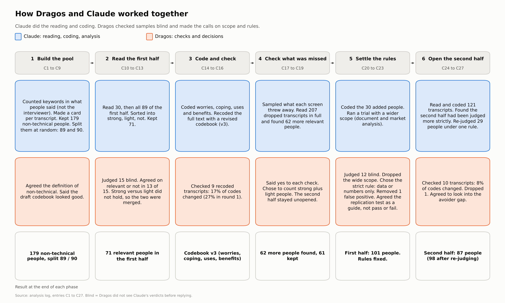

The split matters for trust. One reader, Claude, coded every interview, so Dragos checked small samples (five checks of 9 to 15 transcripts each) and ruled on scope: data or numbers only, one person removed, one dropped. These checks are described later. They reduce the risk of error but do not remove it.

## Who ended up in the analysis

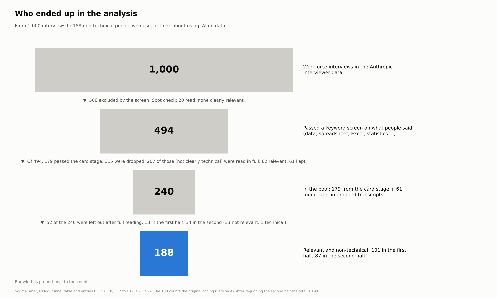

We started with 1,000 workforce interviews and ended with 188 non-technical people who do data or numbers work and use AI on it, or think about using it. A keyword screen cut the pool to 494. We then labelled each of those from a short card, and later re-read 207 of the dropped ones in full to find people the cards had missed.

This is a pool of people who mention data work in a keyword-screened set. It does not describe all workers. Non-technical is Claude's reading of each job intro, and Dragos's check of 15 transcripts agreed with all 15.

## How the people were split

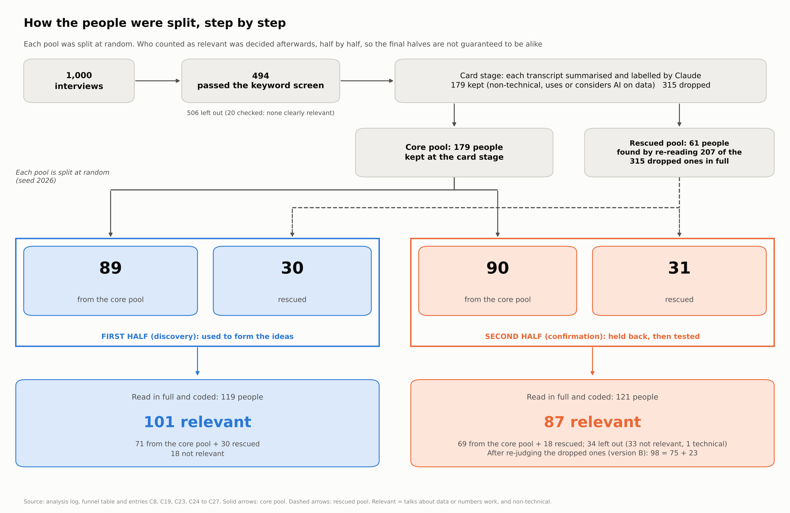

Each pool was split at random into a first half and a second half. The first half (101 relevant people) was used to build the coding scheme. The second half (87 relevant people) was held back, then read and coded against predictions written down first.

The split was random, but who counted as relevant was decided afterwards, half by half. So the final halves are not guaranteed to be alike. Later sections show this matters.

## Checking the screens

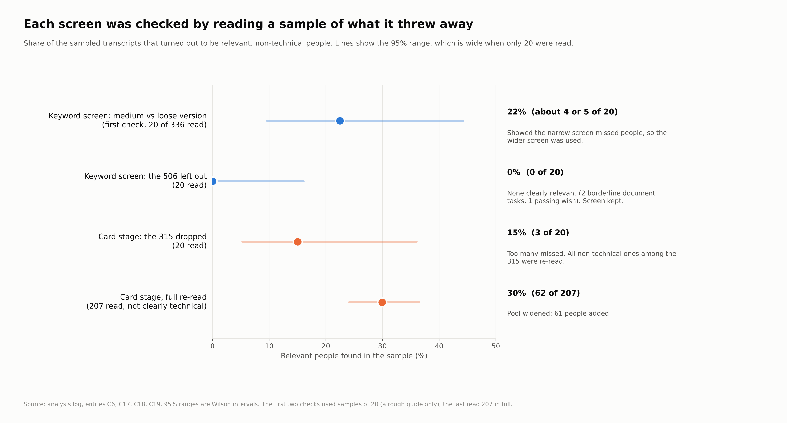

We checked each screening step with small random samples. The keyword screen left out 506 interviews, and 20 of those read showed none clearly relevant. The card stage dropped 315, and 20 of those read showed 3 relevant people, so we re-read 207 of them in full and added 61.

These are small samples, so read them as "probably few missed", not as a rate. Technical-labelled cards were never re-read.

## What we recorded for each person

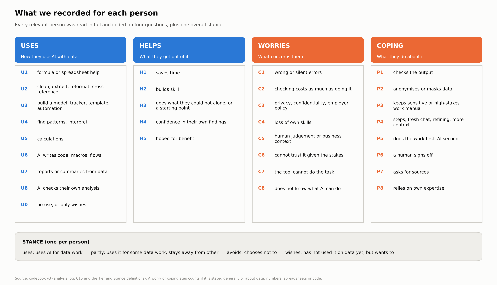

Every relevant person was read in full and coded on four questions: how they use AI with data, what it does for them, what worries them and what they do about it. Each also got one overall stance: uses it, uses some, avoids it, or only wishes to.

A worry or coping step counts when it is stated generally or about data, numbers, spreadsheets or code. Statements about writing or images alone do not count. The scheme was built on the first half and fixed before the second half was coded.

## How often Dragos disagreed with Claude

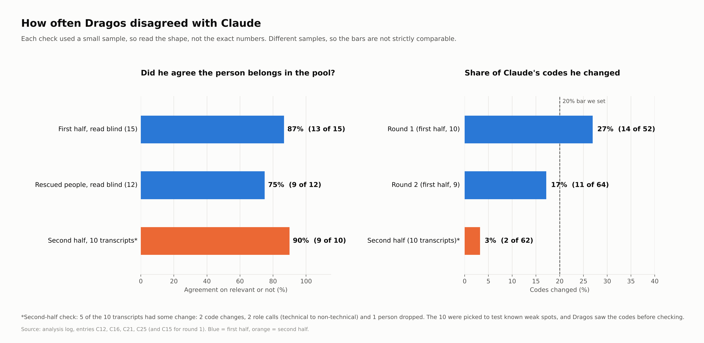

Dragos checked Claude's work five times on small samples. In the two first-half code checks he changed 27% and then 17% of codes, and the coding was "mostly right but incomplete". In the single second-half check he changed 2 of 62 codes (3%). That check was only 10 transcripts, chosen to test weak spots, and he saw the codes first. Five of the 10 still had some change: two codes, two role calls and one person dropped.

The samples differ in size and purpose, so the bars are not strictly comparable. An independent agent that had not seen the work also re-coded 20 transcripts blind. It agreed with Claude on 86% of concern codes, but on 92% of the first-half transcripts against 79% of the second-half ones.

## What people said

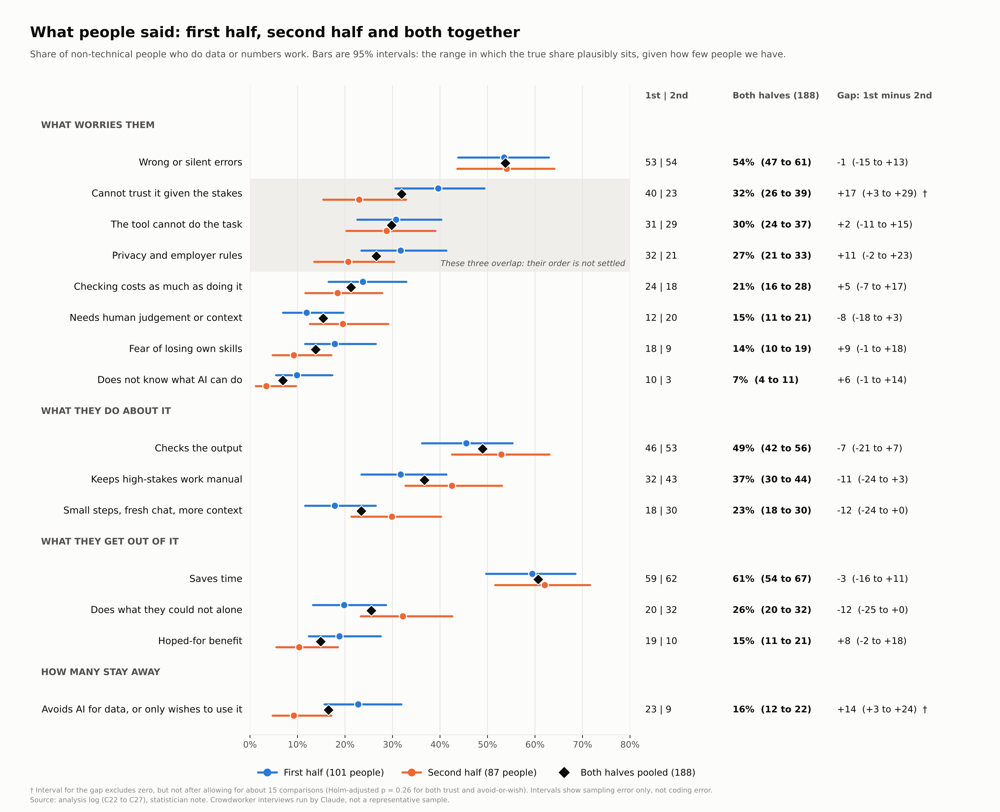

Pooled across both halves (188 people), about half name wrong or silent errors as a worry (54%). Checking the output is the commonest coping step (49%), then keeping high-stakes work manual (37%). About six in ten say AI saves time (61%).

Blue is the first half, orange the second, and the black diamond is both together. Each bar is a 95% interval: the range where the true share plausibly sits, given how few people we have. Trust, "the tool cannot do it" and privacy overlap, so their order is not settled. A dagger marks a gap whose interval excludes zero only before allowing for about 15 comparisons.

## Did the second half confirm the first?

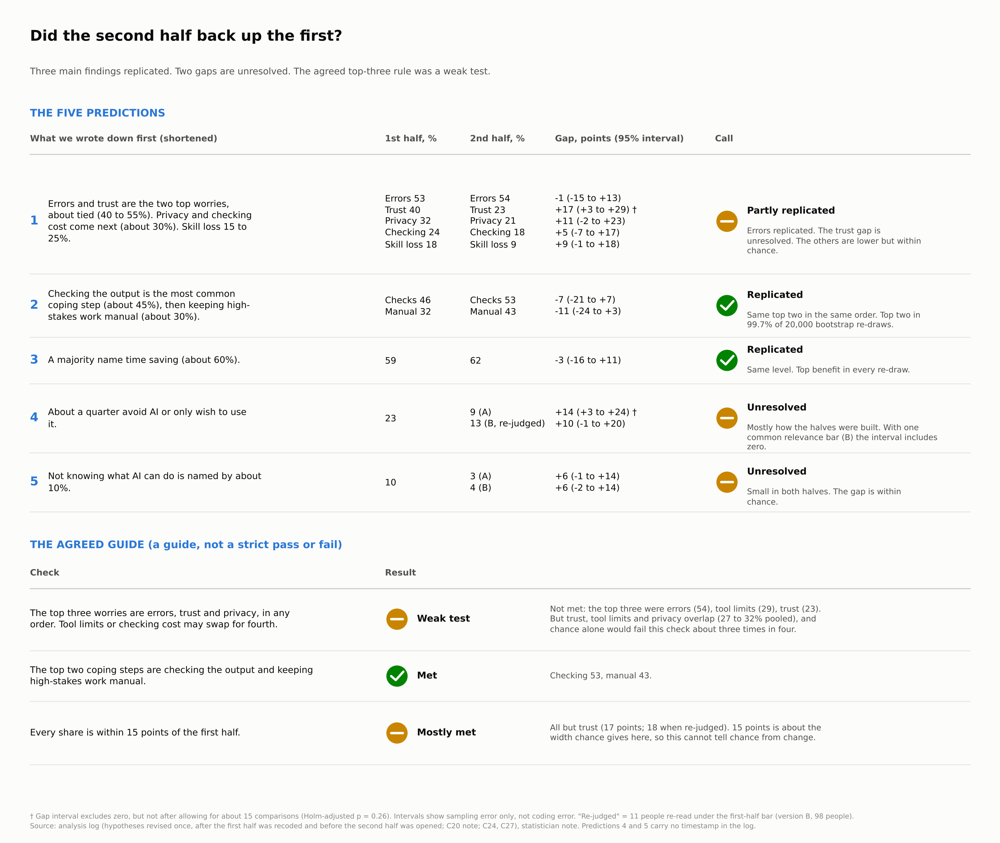

Three findings replicated. Errors came first in both halves. Checking the output and keeping high-stakes work manual were the top two coping steps in both. About six in ten said AI saves time in both.

Two gaps are unresolved. Trust when the stakes are high fell from 40% to 23% (a gap of 17 points, interval +3 to +29). People who avoid AI or only wish to use it fell from 23% to 9% (14 points, interval +3 to +24). Each looks real on its own, but after allowing for the many comparisons we made, neither clears the bar (adjusted p of 0.26 for both).

The agreed rule for the top three worries (errors, trust and privacy, in any order) is a weak test. Trust, "the tool cannot do it" and privacy are close together, so even two random halves of the same data would often disagree on which comes second and third. We report it as not met, and do not read much into that.

## Does it matter how the second half was judged?

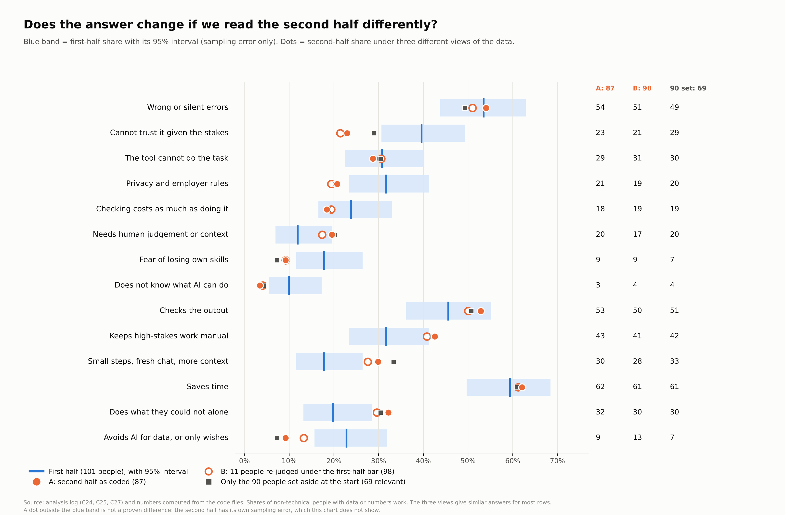

The second half dropped more people as "not relevant" than the first, especially among those we re-read from the dropped pile. So we looked at the second half three ways. Version A is the main one. Version B re-judges 11 people under the first-half bar (98 people). The third view keeps only the 69 core people we never re-read.

The shaded band is the first-half 95% interval. The two unresolved gaps move but do not vanish: under version B the trust gap is still +18 points, and the avoid-or-wish gap shrinks to +10 (interval -1 to +20). Among the 69 untouched core people, 7% avoid AI or only wish to use it. Read the three views as a range, not as three separate answers.

## The people who avoid AI

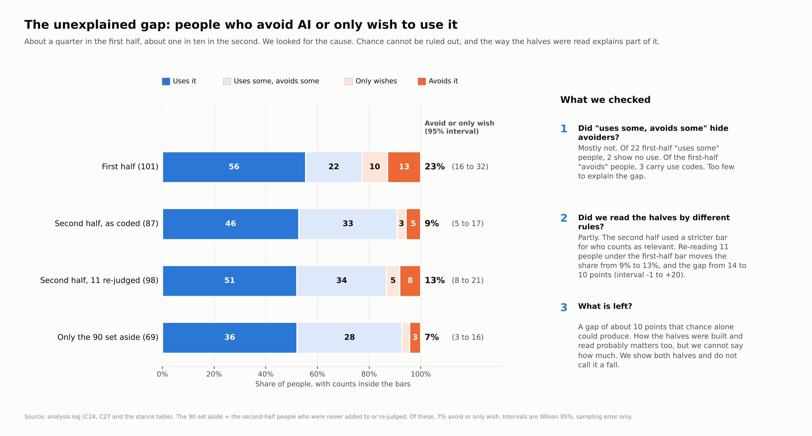

In the first half, 13 people avoid AI and 10 only wish to use it (of 101). In version A of the second half it is 5 and 3 (of 87). In version B it is 8 and 5 (of 98), and in the untouched 69 it is 3 and 2.

The gap sits wholly among core people. One likely cause is the screening cards. The card label "considers or avoids" happened to land on 34 core people in the first half and 27 in the second, and fewer of them survived the stricter second-half bar. Once both halves use the same bar, those card-label people with avoid-or-wish stances are 14 of 34 against 10 of 27 (41% against 37%). Adjusted for card label too, the core gap is +8.5 points (interval -2 to +19), which is compatible with zero.

So we do not claim that avoiders became rarer. We say they were between one in ten and one in four, depending on the half, and that we cannot narrow it further.

## What if we split the 188 at random?

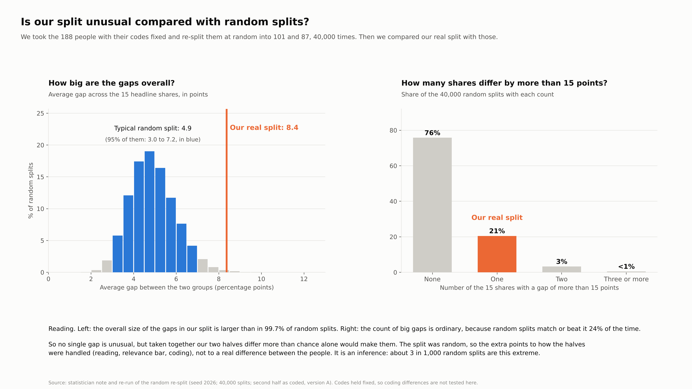

Dragos asked whether the gaps could be chance. We pooled the 188 people, kept each person's codes, and split them into two random halves 40,000 times.

Two results. First, big single gaps are no surprise: we would expect 0.29 gaps over 15 points across the headline shares, and we saw 1. Second, the pattern as a whole is bigger than chance. The average gap across the headline shares was 8.4 points against 4.9 for random splits (95% range 3.0 to 7.2; p about 0.003).

Our reading is that chance alone does not explain it, and that the rest comes from how the halves were built and read, not from different people. That is an inference. The halves were split at random, but who counted as relevant was decided afterwards, half by half. The coding is also fixed in this test, so it cannot show which of those two steps caused the gap.

## What we can and cannot say

**Who did the work.** The interviews in this dataset were run by Claude, and Claude also read and coded them and ran the numbers. Dragos set the questions and rules, checked samples and made the calls on who counted. That is a lot of one model's judgement, and the checks below are there to test it.

**Limits.**

- One reader coded everything, and Dragos saw the codes before he checked them, so his checks were not blind.
- The blind re-code of 20 transcripts was done by another Claude agent, so it is not an independent human check. It agreed on 86% of concern codes, but less on the second half (79%) than the first (92%).
- The people are crowdworkers who agreed to be interviewed. They are not a sample of all workers.
- The rescued group (people we re-read from the dropped pile) stayed relevant much more often in the first half than the second (30 of 31 against 18 of 31).
- We compared about 30 shares, so some gaps will appear by chance. Intervals cover sampling error only, not coding error.
- The order in which we wrote our hypotheses cannot be confirmed from the log.

**Checks done.** An independent agent recomputed every figure from the raw code files. The numbers matched, and the problems it found (validation rates, a stale funnel note, some wording) are fixed. A statistician agent advised on the gaps, and its advice is why the scorecard says "unresolved" and not "failed".

**What would help most.** A second reader who has not seen the codes or the half, re-coding every rescued person and a random 40 core people from each half.

**Credit.** The data is the Anthropic Interviewer dataset (workforce split) from Anthropic, released under CC-BY.

## Outside research and guidance

We found no study of non-technical people analysing data with AI at our scale. The closest are small lab studies, vendor surveys and government guidance, listed below with the argument each makes and the exact figure we took. Read as of 27 October 2026. I read each page's text through a summary tool, not the full paper, so check a figure against its source before you print it.

### Research and surveys

| Source | Type and reliability | What it argues | Figure or quote we took | Used for |
|---|---|---|---|---|
| [Virk and Liu, non-programmers assessing AI-generated code](https://arxiv.org/html/2508.06484v1) | Preprint. A preliminary survey of 10 marketing and sales professionals and a second survey of 18, one model (Llama-3.1-70B). Preliminary | Business professionals cannot reliably verify AI data analyses on their own | 79 flaws identified in the preliminary survey of 10, counting those found by the authors. Participants more often flagged explicit flaws than missing elements. Restructuring the explanation into steps raised detection of one pricing flaw to 8 of 9 from 5 of 10 | Interpretation is the weakly checked part |
| [Databox, using AI you don't trust](https://databox.com/research-reports/using-ai-you-dont-trust) | Vendor survey, June 2026. Just over 100 business users, 44 daily users | Use of AI for analysis is high and trust is not | In the last 30 days, 23% re-derived numbers from the source data and 37% asked a different AI. 74% had at some point shared output based on an AI number that proved wrong | Re-derive the headline number |
| [Drosos and others, "It's like a rubber duck that talks back" (CHIWORK 2024)](https://arxiv.org/pdf/2407.02903) | Conference paper (CHIWORK 2024). 15 data workers, Bing Chat | People check in several ways and sometimes accept results unchecked | Checks included testing formulas or code on sample data. Low-stakes results were accepted without checking. Checking was described as burdensome | Test before you trust. Stakes decide the checking |
| [Microsoft Research survey on critical thinking](https://www.microsoft.com/en-us/research/wp-content/uploads/2025/01/lee_2025_ai_critical_thinking_survey.pdf) | Self-reported survey of 319 knowledge workers. Authors named only in the file name (Lee) | The more people trust AI to do a task, the less critical thinking they report | Confidence in AI was the strongest predictor of less critical thinking (beta -0.69). 114 of 319 mentioned cross-referencing with external sources | Trust relaxes checking over time |
| [Natural language interfaces for databases](https://arxiv.org/html/2511.14718v1) | Preprint. 20 people, all with basic SQL, so not non-technical. A startup supported the tool | People accept AI-written queries early and verify afterwards | Accuracy 75% with the AI tool against 50% without. Trust rating 6.1 against 4.0 | Context only. Not used in the article |
| [Microsoft Research, co-audit](https://advait.org/files/gordon_2024_coaudit.pdf) | Position paper. No new measurements | Checking AI output is getting harder and needs tool support | "Without machine assistance, we fear that audit is often performed poorly by humans." The paper says its evidence is mostly anecdotal | Background to the interpretation point |
| [MIT Sloan ME on Anthropic Interviewer](https://www.mitsloanme.com/article/anthropic-debuts-interviewer-tool-to-understand-how-people-really-use-ai/) | Secondhand news report. I did not read Anthropic's own page | The general workforce mostly finds AI saves time | 86% of the general-workforce group said AI saves them time (our figure is 61%, with different groups and coding) | Context. Not compared in the article |
| [WisdomAI survey](https://www.hpcwire.com/bigdatawire/this-just-in/wisdomai-survey-finds-trust-still-limits-ai-analytics-adoption/) | Vendor survey, May 2026. Over 200 senior data leaders at firms with $1 billion or more in revenue | Trust limits AI analytics adoption | Only 19% were very confident in AI-generated answers | Context for leaders |
| [Alteryx, state of data analysts](https://smartling.alteryx.com/about-us/newsroom/press-release/new-research-reveals-that-ai-brings-productivity-gains-but-reliance-on-spreadsheets-puts-data-quality-at-risk) | Vendor survey, Nov to Dec 2024. 1,400 workers | Spreadsheet reliance can put data quality at risk | 76% still rely on spreadsheets for data preparation | Context only |
| [OWOX, why self-service analytics fails](https://www.owox.com/blog/articles/self-service-analytics-failing.md) | Vendor blog | AI chatbots on raw data are fast but unverifiable | It cites Stanford HAI 2025 for hallucination rates of 17% or more in specialised tools and 58 to 82% in general chatbots. I did not check that source | Not used |
| [AtScale, why ChatGPT gives different answers](https://www.atscale.com/blog/why-chatgpt-gives-different-answers-business-data/) | Vendor blog. Figures are its own benchmarks | Without governed definitions the AI picks the table, join and filter each time | Accuracy of about 70% without a semantic layer and 95 to 100% with one | Not used in the article. Background to the governed-definitions idea |

### Best-practice guidance

| Source | Type | Advice we took | Used for |
|---|---|---|---|
| [GOV.UK analysts' guide to using AI](https://docs.data-community.publishing.service.gov.uk/analysis/best-practice/using-ai) | Government guidance | Avoid AI for tasks you are unfamiliar with, "because you may not be able to tell whether the output is accurate". Review all outputs. Document AI use as you would any other method. Do not put data into non-enterprise tools | Monday box: judge what you delegate, write down AI use, approved tools |
| [Australian Treasury tips for quantitative analysis](https://evaluation.treasury.gov.au/sites/evaluation.treasury.gov.au/files/2025-10/prompting-tips-using-ai-tools-prepare-quantitative-data-analysis.pdf) | Government guidance, October 2025 | "Any AI-based decisions and products must be owned by the officers." Use AI for repetitive checks but review its findings yourself. Ask for references and a data dictionary | Monday box: give checking an owner |

### What we could not read

- The ICAEW article on identifying AI errors in financial models returned only its navigation, so nothing from it is used.
- The CHI 2024 paper on how analysts verify AI-assisted analyses (Gu and others, Microsoft Research): I read only its summary page. It confirms 22 analysts and that backgrounds shaped verification, but not the specific behaviours.
- No source tests whether the Monday box steps reduce errors. Two of them (name an owner for checking, treat interpretation as the risky part) are our reading of our own evidence and not a finding from any source.
